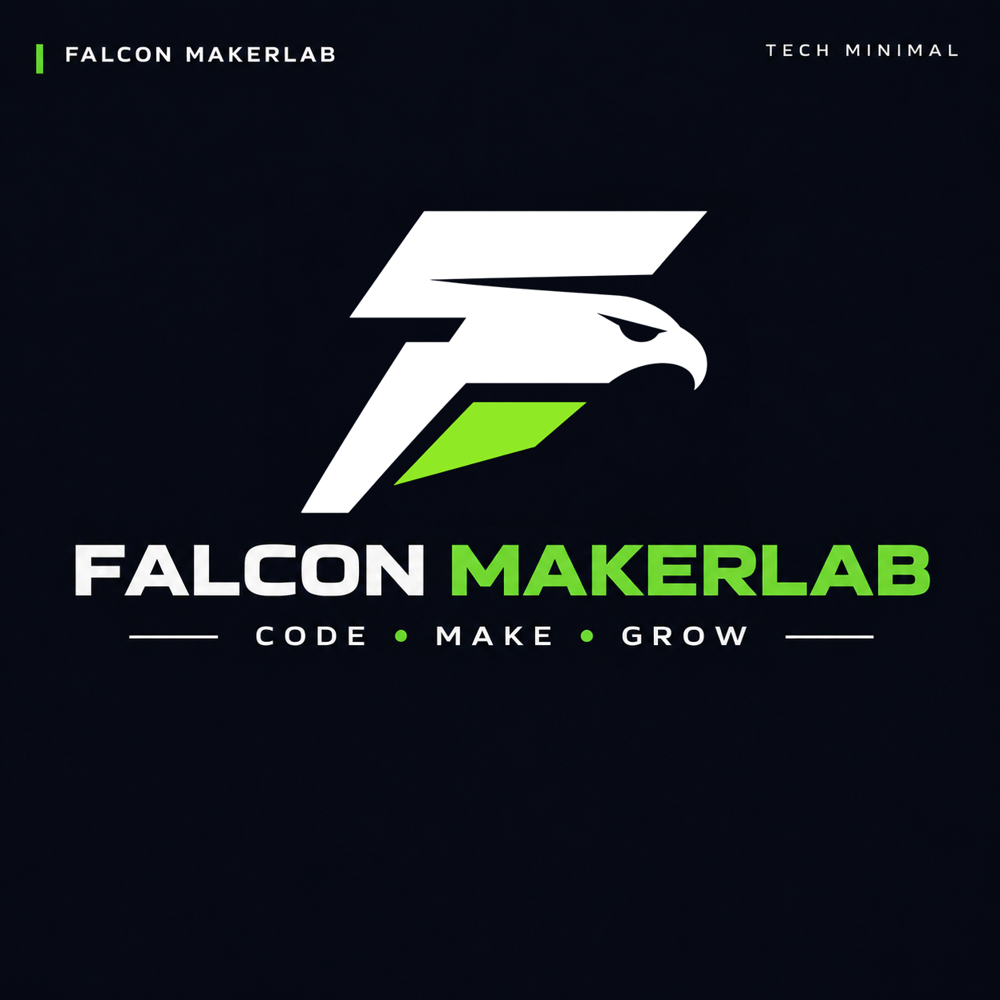

  

### Code • Make • Grow

Software · Electronics · 3D Printing · Garden

 

[Website](https://falcon-codes.pl) ·
[YouTube](https://www.youtube.com/@falconmakerlab) ·
[Instagram](https://www.instagram.com/falconmakerlab) ·
[TikTok](https://www.tiktok.com/@falconmakerlab)

---

## About

**Falcon MakerLab** is a collection of practical projects combining software, electronics, 3D printing and gardening.

The focus is on building useful things, testing them in real-world conditions and documenting the process.

---

## 01 / CODE

Software, automation and embedded systems.

Backend applications, APIs, Raspberry Pi / Pico software, monitoring and tools supporting physical projects.

---

## 02 / MAKE

Electronics, prototyping and 3D printing.

Controllers, sensors, custom enclosures, CAD models and practical DIY solutions.

---

## 03 / GROW

Technology applied in the garden and greenhouse.

Irrigation, monitoring, automation and real-world testing of hardware and 3D printed parts.

---

## Projects

Projects published here may include:

- source code
- firmware
- wiring diagrams
- 3D models
- hardware documentation
- build notes
- test results

---

**Falcon MakerLab**

Code • Make • Grow

